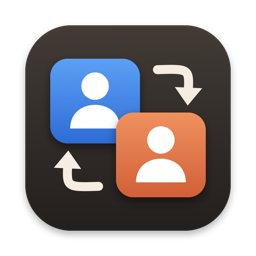
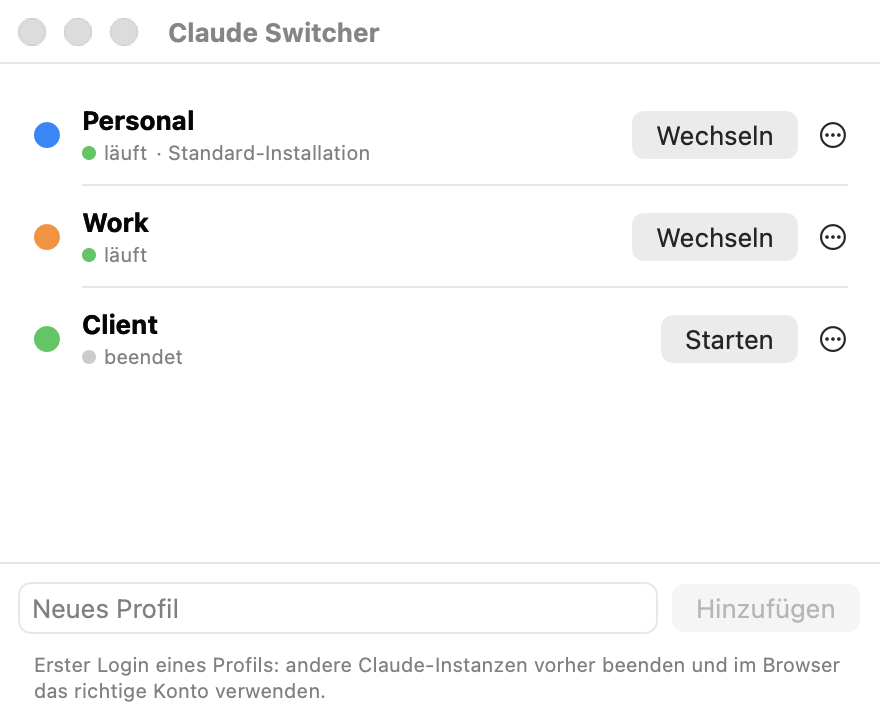

# Claude Switcher

A tiny macOS menu bar app to run several Claude Desktop accounts side by side, e.g. personal and work. Each profile gets its own [`--user-data-dir`](https://philippstracker.com/multiple-claude-instances/).



## Install

Requires macOS 15+, Claude Desktop and the Xcode Command Line Tools.

```bash
git clone https://github.com/jdmmnn/claude-switcher.git
bash claude-switcher/ClaudeSwitcher/build.sh
open ~/Applications/"Claude Switcher.app"
```

## Use


One dot per running profile: **filled** is in front, **ring** is in the background.

Click a profile in the menu to start it or bring it forward; click it again to hide it. Manage profiles via *Profile verwalten…* (the UI is in German).

## Claude Code CLI

Assign folders to a profile (*⋯ → Claude-Code-Ordner zuordnen…*) and add this to your `~/.zshrc`:

```bash
source ~/.config/claude-switcher/claude.zsh
```

Inside those folders `claude` uses its own `CLAUDE_CONFIG_DIR` (login, history, settings, skills, MCP servers); everywhere else it uses `~/.claude`. Works in interactive zsh only.

## Good to know

- For a profile's first login, quit the other Claude instances and check the account in your browser.
- Folder assignment affects the terminal CLI only, not the desktop app's Code tab.

---

[MIT](LICENSE). Unofficial project, not affiliated with or endorsed by Anthropic. "Claude" is a trademark of Anthropic.
